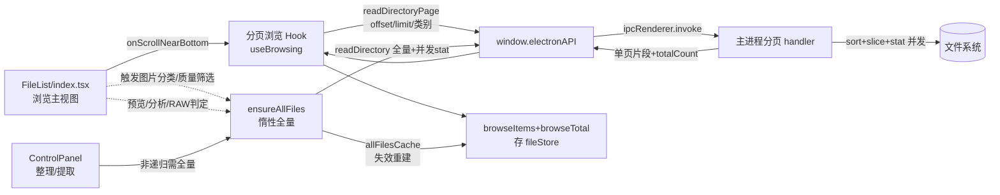

## 需求概述

徐工要求：打开新文件夹时，不要一次性读取全部文件并渲染，而应采用分页/增量方式读取，提升打开大目录的速度。

## 产品概述

「文件整理工具」在用户切换/进入文件夹时，由主进程全量读取目录下所有条目并对每个条目串行执行 stat，再一次性通过 IPC 传输到渲染进程；前端把整份数组存入 store 后做纯客户端 slice 假分页。目录较大时，主进程串行 stat 慢、IPC 全量传输慢、渲染进程内存持有全量数组。

## 核心功能

- 浏览主界面改为"滚动到底自动加载更多"的增量加载体验，而非整页刷新/客户端 slice。
- 打开文件夹、进入子目录、返回、历史回退、切换目录后，分页浏览状态正确重置并只按需加载。
- 保留全量数据能力供"必须看整个目录才能工作"的功能（整理预览、文件提取、图片分类/质量筛选、图片分析、RAW/LivePhoto 兄弟文件判定、媒体预览整目录翻页、跨页选择）使用，采用按需惰性加载，避免首屏卡顿。
- 文件新增/删除/重命名/整理等变更后，浏览数据与全量副本能保持一致或正确失效重建。

## 技术栈

- 沿用现有技术：Electron 主进程 + preload + React 18 + TypeScript + antd 5 + zustand + Tailwind。
- 不新增 npm 图标/组件依赖；分页采用"offset/limit + 服务端排序稳定切片"方案，复用项目现有 IPC 通道注册、统一导出、简中文案等约定。

## 总体实现思路

现状瓶颈集中在主进程对整目录"串行 stat + 全量 IPC 返回"，而渲染层却只需展示当前一小屏。方案核心是**解耦"浏览视图"与"依赖全目录的功能"两套数据需求**：

1. 主进程新增一个"排序稳定 + 可选扩展名过滤"的分页读取能力，返回当前切片条目 + 该切片前的总数/是否还有更多，主界面仅按当前已滚动位置向服务端取新页并追加渲染（滚动增量）。
2. `imageClassificationResults`（图片内容分类/质量）只存在于前端内存 Map，服务端无法按它分页，因此当用户切到图片分类/质量筛选态时，浏览分页无法继续走服务端，需回退到"全量副本 + 前端过滤"。
3. 整理预览/文件提取/图片分析/RAW 判定/媒体预览等只在用户主动触发时才需要全目录数据，改为惰性加载到单独的全量副本，不随首屏一起全量读取。
4. 保持 FileListTable/FileListGrid 组件外观与接口稳定，仅把数据源从"父组件 slice 的单页"改为"已加载的累计片段 + totalCount"，并把页码条交互改造成"滚动到底触发加载下一页 + 加载中提示 + 全部加载完提示"。

## 架构设计



组件与数据关系：

- `fileStore` 拆分为两组浏览字段（`browseItems`、`browseTotal`、`browseLoading`、`browseDone`、当前已加载的浏览 offset）与惰性全量副本（`allFilesCache`、`allFilesLoaded`、当前路径快照）；原 `fileList` 语义迁移到 `allFilesCache` 对应使用点。
- `useFileSystem.loadDirectory` 改为"重置分页浏览态 + 加载首页切片"，同时失效全量副本；新增 `ensureAllFilesLoaded(path)` 惰性拉全量。
- `FileList/index.tsx` 中所有依赖全量数组的派生（filteredFileList、siblingNames、analyzableImageCount、getImageFiles/sameKindFiles、handleAnalyzeImages 的 imagePaths、网格全量反查）统一改为读取 `allFilesCache`，并在首次需要时先 `ensureAllFilesLoaded`。
- `FileListTable/FileListGrid` 只接收"累计片段 dataSource + total"，滚动触底回调由父组件接管加载下一页。

## 关键决策与权衡

- **offset/limit 而非游标**：因为当前按"文件夹在前→名称"排序且无变动列表，offset/limit 配合"服务端一次性生成稳定排序的整目录排序表再切段"即可保证滚动不重复/不缺漏，实现最直接。目录加载时先做一次仅含 name/isDirectory 的轻量排序，再对目标切片做并发 stat，避免对未展示文件做无谓 stat。
- **筛选三态处理**：
- 默认"全部"分类 → 服务端分页（不传扩展名过滤或按空过滤）。
- 类别/扩展名筛选 → 服务端可在主进程内按目录标志/扩展名过滤后再分页，总数即过滤后总数。
- 图片分类/质量筛选 → 服务端无法计算，切回惰性全量副本做前端过滤。
- **并发 stat 替代串行**：主进程对目标切片内条目用并发(如 32~64)执行 stat，显著缩短首屏与每页耗时；全量惰性加载同样复用并发 stat。
- **一致性**：任何文件变更操作（增删改/重命名/提取/整理落地）触发 `loadDirectory(currentPath)` 或显式失效，从而重建浏览片段并清空全量副本缓存。
- **性能**：首屏仅对第一页条目做 stat 并 IPC 返回，内存中不持有全量 FileInfo；滚动追加页仅取当前所需；大目录不再一次性全量传输。预计首屏耗时从 O(N) 串行 stat + O(N) 传输降为 O(pageSize) 并发 stat，滚动体验接近流式。

## 实现注意

- 只在 `electron/main/main.ts` 内新增/修改分页 handler；勿动冗余副本 `electron/main/services/fileService.ts`（若当前未被 main 引用则保持不动）。
- IPC/preload 需同时扩展类型声明（`electron/types`、`preload` 中 electronAPI 接口）并在 DEVELOPMENT.md 记录 API 变更。
- 新增函数/hook/store 字段必须加入对应 `src/utils`、`src/hooks`、`src/stores`、`src/components` 的 index.ts 统一导出，禁止直连子模块导入。
- 代码标识符用英文，用户可见文案用简体中文；交互/视觉沿用现有 macOS/SF 风格与 antd 控件，不新增图标依赖。

## 目录结构

```
electron/main/main.ts                    # [MODIFY] 改造 fs:readDirectory 支持并发 stat；新增 fs:readDirectoryPage(offset,limit,dirsFirst,extFilter?) 返回{items,totalCount,hasMore}
electron/preload/preload.ts              # [MODIFY] 新增 electronAPI.readDirectoryPage(...)；扩展 electronAPI 接口与类型
src/types/electron.d.ts (或等价类型文件)  # [MODIFY] 新增分页接口入参/返回类型 PageResult<FileInfo>
src/stores/fileStore.ts                  # [MODIFY] 拆分浏览字段 browseItems/browseTotal/browseLoading/browseDone；新增惰性全量副本 allFilesCache/allFilesLoaded/路径快照与失效逻辑
src/hooks/useFileSystem.ts               # [MODIFY] loadDirectory 改为分页首页加载+重置浏览态+失效全量；新增 ensureAllFilesLoaded、loadBrowsePage(offset)
src/hooks/useBrowsing.ts                 # [NEW] 浏览滚动增量 hook：管理已加载片段、触底回调、加载更多、竞态保护
src/components/FileList/index.tsx         # [MODIFY] 改用浏览片段+total；filteredFileList/siblingNames/预览/分析等改读 allFilesCache 并 ensureAllFilesLoaded；接入滚动触底
src/components/FileList/FileListTable.tsx # [MODIFY] dataSource 接收累计片段；保留受控 pagination 但交由父级做滚动加载提示；或隐藏页码条改为"加载更多"行
src/components/FileList/FileListGrid.tsx  # [MODIFY] 同上，底部改滚动容器触底 onLoadMore + "已全部加载"提示
src/components/ControlPanel.tsx           # [MODIFY] 非递归整理/提取前 ensureAllFilesLoaded(currentPath) 用全量副本
src/components/FileTree.tsx               # [MODIFY] 清空浏览态与全量副本保持一致
src/stores/index.ts / src/hooks/index.ts  # [MODIFY] 导出新 hook/store
```

## 关键结构（接口级）

```ts
// 主进程 → 前端 分页读取结果
interface DirectoryPage {
  items: FileInfo[]      // 当前页条目（已 stat，按 文件夹在前→名称 稳定排序切片）
  totalCount: number     // 过滤后(若无图片筛选)或全量条目总数，用于展示"共 N 项"
  hasMore: boolean       // offset+items.length < totalCount，供滚动触底判断
}
// 前端分页浏览状态
interface BrowsingState {
  items: FileInfo[]      // 已加载的累计片段
  totalCount: number
  loading: boolean
  done: boolean          // 已全部加载（含命中上限或图片筛选回退前端分页）
}
```

说明：`readDirectoryPage` 由 `useFileSystem.loadBrowsePage(offset, limit)` 调用，`useBrowsing` 负责在 FileList 容器滚动近底时递增 offset 拉取并追加；目录切换/进入子目录/返回/筛选条件变化时重置 `BrowsingState` 并重新加载首页。

## Agent 扩展

### SubAgent

- **code-explorer**
- 用途：在执行阶段用于精确检索 `fileList`、`imageClassificationResults`、`filteredFileList`、`siblingNames`、`getImageFiles`、`handlePreview`、`handleAnalyzeImages`、`ControlPanel` 预览/整理、`FileTree` 等全部消费点，确保将浏览数据与惰性全量副本两套数据改到每一处调用点，不漏改、不错改。
- 预期产出：提供完整影响点清单（文件+行号+用途），支撑 index.tsx/ControlPanel/fileStore 改造的逐点落实。