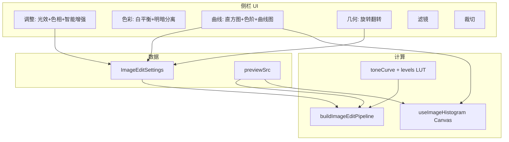

# 图片编辑器：专业控件 + 曲线/色阶 + 几何工具

## 现状摘要

| 区域     | 现状                                                                                                                                             |
| -------- | ------------------------------------------------------------------------------------------------------------------------------------------------ |
| 侧栏分段 | [`EditorSegmentNav`](src/components/ImageEditor/EditorSegmentNav.tsx)：`调整 / 色彩 / 滤镜 / 裁切`                                               |
| 控件     | 通用 [`ControlRow`](src/components/ImageEditor/editorControlPrimitives.tsx)；色温/色调已有渐变轨                                                 |
| 几何     | 旋转/翻转挤在 [`EditorCropPanel`](src/components/ImageEditor/EditorCropPanel.tsx)                                                                |
| 管线     | [`buildImageEditPipeline`](electron/main/utils/imageUtils.ts) 支持裁切、旋转、翻转、modulate、gamma、阴影/高光等；**无色阶三点、无色调曲线 LUT** |
| 预览     | `previewEdits` 降采样 1280px；设置变更 debounce 300ms                                                                                            |

**徐工确认的首期范围**：专业控件 + **几何工具页** + **色阶/自动色阶（与直方图联动）** + **曲线面板**。

---

## 总体架构



---

## 阶段 A：专业控件（调整页）

（与原计划一致，徐工已选 **直方图实时**）

| 控件         | 实现要点                                                                                                                                             |
| ------------ | ---------------------------------------------------------------------------------------------------------------------------------------------------- |
| **色相**     | `HueControlRow`：0–360° 彩虹 `railGradient`；拇指色块 `hsl(value, 85%, 52%)`                                                                         |
| **曝光**     | `ExposureControlRow`：上方 [`EditorHistogram`](src/components/ImageEditor/EditorHistogram.tsx)；暗→亮轨道；直方图随 `previewSrc` debounce 280ms 更新 |
| **其它光效** | 饱和度/亮度/对比度补充 tonal `railGradient`                                                                                                          |

**新增文件**

- [`src/utils/imageHistogram.ts`](src/utils/imageHistogram.ts) — `computeLuminanceHistogram`（最长边 320px 采样）
- [`src/hooks/useImageHistogram.ts`](src/hooks/useImageHistogram.ts) — debounce + generation 取消
- [`src/components/ImageEditor/EditorHistogram.tsx`](src/components/ImageEditor/EditorHistogram.tsx)
- [`src/components/ImageEditor/editorSpecialControls.tsx`](src/components/ImageEditor/editorSpecialControls.tsx) — `HueControlRow`、`ExposureControlRow`

**数据流**

```ts
const previewSrc = sharpPreviewUrl ?? imageUrl ?? originalImageUrl ?? null;
```

`ImageEditor` → `EditorSidebar` → `EditorAdjustPanel`（及后续 `EditorCurvesPanel` 共用直方图）。

---

## 阶段 B：曲线 / 色阶面板（新分段「曲线」）

### B1 类型与管线

扩展 [`ImageEditSettings`](src/types/index.ts)：

```ts
/** 色阶：输入黑点/白点 0–255，中间调 gamma 50–200（100=原始） */
levels?: { black: number; white: number; gamma: number }

/** 主曲线控制点，x/y 归一化 0–1；至少含 (0,0) 与 (1,1) */
toneCurve?: { master: Array<{ x: number; y: number }> }
```

新增 [`src/utils/toneCurve.ts`](src/utils/toneCurve.ts)：

- `buildLevelsLut(levels)` — 黑点/白点/伽马 → `Uint8Array(256)`
- `buildCurveLut(points)` — 单调三次样条或分段线性，保证 0–255 单调
- `composeLuts(levels, curve)` — 色阶后再套曲线
- `computeAutoLevels(bins)` — 按累计 0.5% / 99.5% 分位算黑/白点（常见自动色阶）

[`buildImageEditPipeline`](electron/main/utils/imageUtils.ts) 在色彩调整段**末尾**（或锐化前）增加：

```ts
if (settings.levels || settings.toneCurve) {
  const lut = composeLuts(...)
  sharpInstance = applyToneLut(sharpInstance, lut) // raw 通道映射，预览尺寸可接受
}
```

`applyToneLut`：对降采样预览走 in-memory LUT；全尺寸 `applyEdits` 同逻辑，注意性能（可仅对 >4K 提示或保持与预览一致）。

### B2 UI — `EditorCurvesPanel`

新建 [`src/components/ImageEditor/EditorCurvesPanel.tsx`](src/components/ImageEditor/EditorCurvesPanel.tsx)：

| 区块 | 内容                                                                                                          |
| ---- | ------------------------------------------------------------------------------------------------------------- |
| 顶部 | 共用 `EditorHistogram`（实时）+ 裁切/过曝警示条                                                               |
| 色阶 | 黑点 / 中间调 / 白点 三个 `ControlRow`（轨道：黑→白）；**自动色阶**按钮调用 `computeAutoLevels` 写入 `levels` |
| 曲线 | SVG 256×256 逻辑坐标系；默认对角线；可拖拽 3–5 个控制点；双击点删除（保留首尾）；**重置曲线**                 |
| 底部 | 面板级「重置本页」→ `resetEditPanel('curves')`                                                                |

交互细节：

- 拖曲线点时 `onChange` 更新 `toneCurve`，触发既有 `previewEdits` debounce
- 色阶与曲线共用一个 LUT 链，避免重复请求可合并 settings 哈希

**首期曲线范围**：仅 **RGB 主曲线**（单通道 LUT 同时作用于 R/G/B）；通道分色（R/G/B 独立曲线）列入二期。

### B3 分段导航

[`EditorSegmentNav`](src/components/ImageEditor/EditorSegmentNav.tsx) 增加：

- `curves` — 标签「曲线」，图标 `TbChartLine` 或 `TbActivity`（从 [`src/components/icons/index.ts`](src/components/icons/index.ts) 导出）
- `EditorToolKey` 扩展：`adjust | color | curves | geometry | effects | crop`

[`EditorSidebar`](src/components/ImageEditor/EditorSidebar.tsx) 增加 `case 'curves'`。

[`resetEditPanel`](src/utils/imageEditorUtils.ts) 增加分组 `'curves'`：清空 `levels`、`toneCurve`。

---

## 阶段 C：几何工具页（新分段「几何」）

新建 [`src/components/ImageEditor/EditorGeometryPanel.tsx`](src/components/ImageEditor/EditorGeometryPanel.tsx)：

| 功能      | UI                  | 行为                                    |
| --------- | ------------------- | --------------------------------------- |
| 左旋 90°  | 图标按钮            | `rotation: (rotation - 90 + 360) % 360` |
| 右旋 90°  | 图标按钮            | `rotation: (rotation + 90) % 360`       |
| 旋转 180° | 按钮                | `rotation: (rotation + 180) % 360`      |
| 水平翻转  | Switch / 按钮       | `flipHorizontal` 取反                   |
| 垂直翻转  | Switch / 按钮       | `flipVertical` 取反                     |
| 精细角度  | `ControlRow` 0–360° | 保留现有 `rotation` 字段（拉直/微调）   |

从 [`EditorCropPanel`](src/components/ImageEditor/EditorCropPanel.tsx) **移除**旋转/翻转区块，裁切页只保留比例预设、裁切开关、坐标（与 [`CropOverlay`](src/components/ImageEditor/CropOverlay.tsx) 联动）。

`resetEditPanel('transform')` 已含 rotation/flip；几何页重置调用该分组。

---

## 阶段 D：样式与文档

[`src/styles/editor.css`](src/styles/editor.css) 新增：

- `.editor-histogram`、`.editor-curves-chart`、`.editor-curves-point`、`.editor-geometry-actions`（按钮网格 macOS 风格）
- 曲线区使用 `--app-surface-subtle`、`--app-primary` 控制点描边

文档：

- [`docs/image-editor-design.md`](docs/image-editor-design.md) — 更新工具分段、色阶/曲线/几何说明
- [`DEVELOPMENT.md`](DEVELOPMENT.md) — 记录 `ImageEditSettings` 新增字段（无新 IPC 路径，仍走 `image:previewEdits`）

---

## 二期（已完成，2026-05-20）

| 功能                        | 说明                                                                                  |
| --------------------------- | ------------------------------------------------------------------------------------- |
| 直方图拖拽黑/白场           | 与色阶滑杆双向绑定                                                                    |
| RGB 分通道曲线              | R/G/B 独立 LUT                                                                        |
| RGB 直方图叠层              | 曲线页开关                                                                            |
| HSL 分色相 8 色             | 色彩页折叠面板                                                                        |
| 画布取色 / 灰点白平衡       | 点击预览设 `temperature`/`tint`                                                       |
| 去雾 / 鲜明度               | 新参数 + Sharp 像素近似                                                               |
| 水印 / 导出尺寸             | [`FormatCompressDialog`](src/components/ImageEditor/FormatCompressDialog.tsx)         |
| 主进程 `image:getHistogram` | ≥4K 像素回退                                                                          |

**合并提交**：`1897be1` feat: Enhance image editing features and introduce media local protocol

---

## 不在本期

- 局部画笔、修复笔、AI 抠图
- 引入新 npm 包（曲线/直方图均 Canvas + SVG）

---

## 验证清单

1. **调整页**：色相彩虹轨、曝光+实时直方图、渐变轨正常；深色主题可读。
2. **曲线页**：拖曲线/色阶后预览约 300ms 更新；自动色阶合理；重置恢复默认对角线与 0–255 色阶。
3. **几何页**：90° 旋转与翻转在预览中正确；与裁切同时使用时顺序符合管线（裁切→旋转→色彩）。
4. **裁切页**：无旋转/翻转控件，裁切框仍可用。
5. **保存**：`applyEdits` 输出包含 levels/curve 效果；无类型与 IPC 契约破坏（仅扩展 settings JSON）。

---

## 关键文件一览

| 变更类型 | 文件                                                                                                                                                                                                                   |
| -------- | ---------------------------------------------------------------------------------------------------------------------------------------------------------------------------------------------------------------------- |
| 类型     | [`src/types/index.ts`](src/types/index.ts)                                                                                                                                                                             |
| 管线     | [`electron/main/utils/imageUtils.ts`](electron/main/utils/imageUtils.ts)                                                                                                                                               |
| 工具     | `imageHistogram.ts`、`toneCurve.ts`、[`imageEditorUtils.ts`](src/utils/imageEditorUtils.ts)                                                                                                                            |
| Hook     | `useImageHistogram.ts`                                                                                                                                                                                                 |
| UI       | `EditorHistogram.tsx`、`editorSpecialControls.tsx`、`EditorCurvesPanel.tsx`、`EditorGeometryPanel.tsx`、`EditorAdjustPanel.tsx`、`EditorCropPanel.tsx`、`EditorSegmentNav.tsx`、`EditorSidebar.tsx`、`ImageEditor.tsx` |
| 样式     | [`src/styles/editor.css`](src/styles/editor.css)                                                                                                                                                                       |
